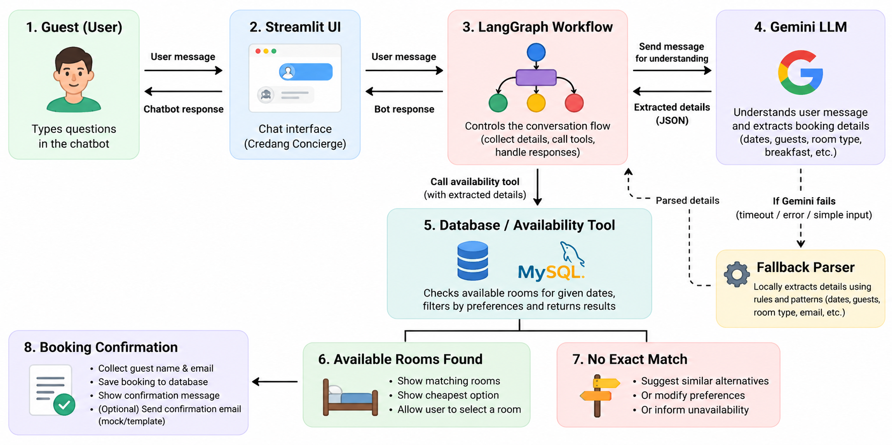

# Grand Credang — Hotel Booking Agent

Grand Credang is a Streamlit-based hotel booking assistant. Guests can check room availability, compare prices, choose a room, and confirm a booking through a chat interface.

## Architecture

- **Streamlit (`app.py`):** Provides the hotel interface and chatbot.
- **LangGraph (`agent/workflow.py`):** Manages conversation state and decides which step to run next.
- **Gemini LLM:** Interprets guest messages and extracts structured booking details, such as dates, bed type, breakfast preference, number of guests, and intent.
- **Fallback parser:** Uses local rules and patterns to handle supported simple inputs or act when the Gemini call fails or times out.
- **Availability tool (`tools/availability.py`):** Queries MySQL for rooms that match the requested dates and preferences, including booking-overlap checks.
- **Booking tool (`tools/booking.py`):** Rechecks availability and saves the reservation after the guest explicitly confirms.
- **Email service (`services/email_service.py`):** Creates a mock confirmation email for display; it does not send a real email.


## Architecture

<p align="center">
  
</p>

## How the LLM and database/tool interact

1. The guest sends a message through the Streamlit chatbot.
2. LangGraph sends the message to Gemini to identify the guest's intent and extract any booking details.
3. If Gemini fails or times out, or if a supported simple input can be handled locally, the fallback parser extracts common details such as dates, preferences, room numbers, names, and email addresses. Ambiguous inputs may still require clarification.
4. When the required details are available, LangGraph calls the availability tool.
5. The availability tool queries MySQL and returns matching rooms and prices. If there is no exact match, the chatbot can suggest alternatives or explain that no suitable room is available. Room availability and prices come from the database tool, not from the LLM's guesses.
6. After the guest selects a room, the chatbot collects the guest's name and email and asks for explicit confirmation.
7. When confirmed, the booking tool checks availability again and saves the booking in MySQL. The app then displays a mock confirmation email.

## Requirements

- Python 3.11 or newer
- MySQL 8.x
- Gemini API key
- Python packages listed in `requirements.txt`

## How to run (Windows PowerShell)

Run the following commands from the project folder.

### 1. Create and activate a virtual environment

```powershell
py -m venv .venv
.\.venv\Scripts\Activate.ps1
python -m pip install --upgrade pip
python -m pip install -r requirements.txt
```

### 2. Set up MySQL

Open `database/schema.sql` in MySQL Workbench and execute it to create the database and tables.

### 3. Configure environment variables

Copy `.env.example` to `.env` and enter your own credentials:

```dotenv
GEMINI_API_KEY=your_gemini_api_key
DB_HOST=localhost
DB_PORT=3306
DB_USER=root
DB_PASSWORD=your_mysql_password
DB_NAME=hotel_booking
```

Keep `.env` private. Do not commit or share API keys or database passwords.

### 4. Add demo rooms

```powershell
python -m database.seed
```

### 5. Run the application

```powershell
python -m streamlit run app.py
```

Open the local URL printed in the terminal, usually `http://localhost:8501`.

## Quick test

- Search for rooms using future dates and preferences.
- Ask for the cheapest available room and check the total price.
- Try a search with no exact match and review the alternatives.
- Select a room, enter a guest name and email, and confirm the booking.
- Decline a booking and check that no reservation is created.
- Try invalid dates or a date range with no available rooms.

Run the tests with:

```powershell
python -m pytest -q
```

## Limitations

This is a demo prototype. It does not process payments, send real emails, calculate taxes or additional fees, or support multi-room bookings. Use a test database when checking booking conflicts.
